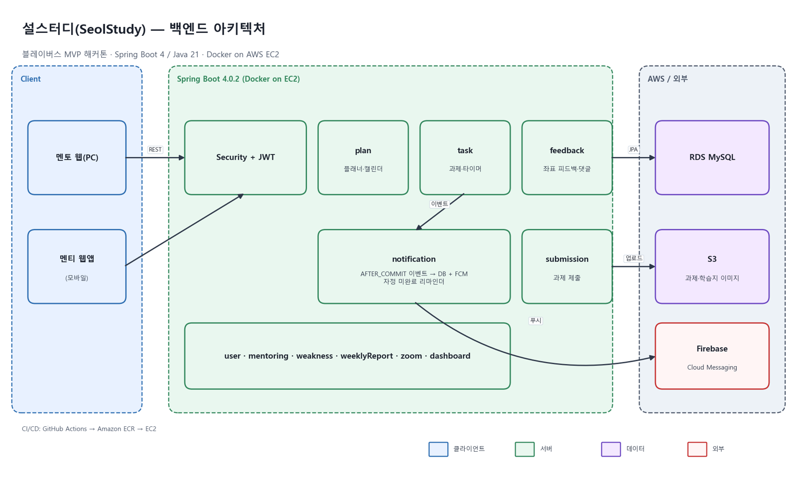
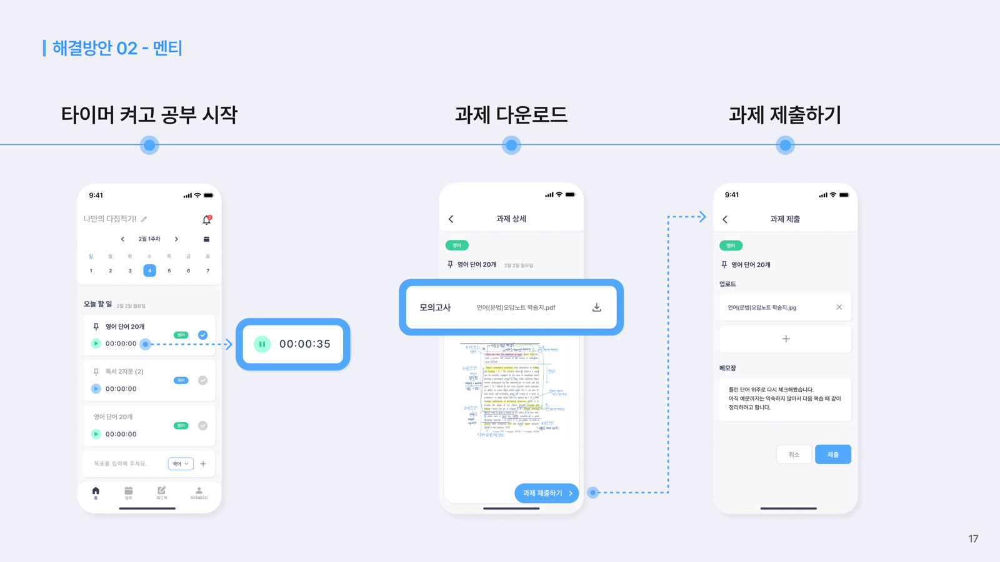
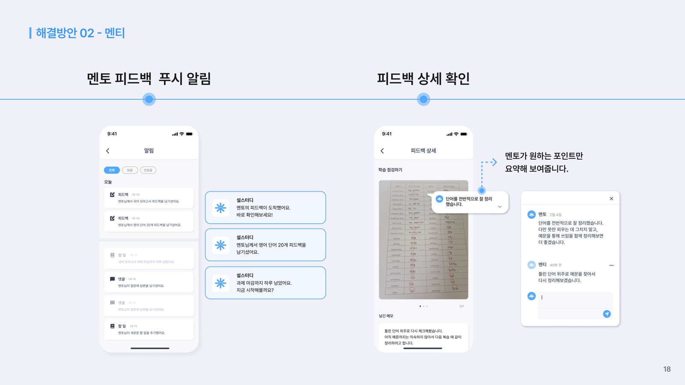
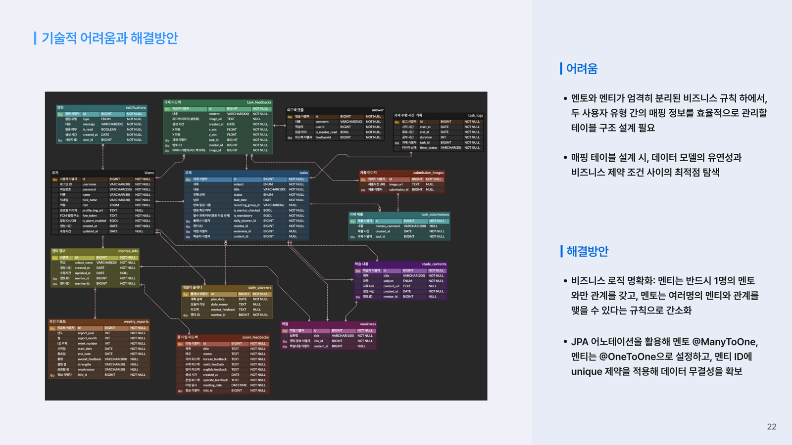

# 📘 설스터디 × INNOV

**멘토·멘티 1:1 맞춤형 수능 학습 관리 플랫폼 (MVP)**

---

## 프로젝트 소개

파트너사 **설스터디**(자체 콘텐츠 기반 수능 국영수 학습코칭)의 기획을 받아, 해커톤 기간 안에 MVP로 구현한 서비스입니다. 수험생(멘티)의 학습이 **플래너 → 과제 → 제출 → 피드백**으로 끊기지 않고 이어지도록, 멘토의 관리 부담은 줄이고 멘티에게는 스스로 성장하는 흐름을 만드는 것을 목표로 했습니다.

## 핵심 기능

| 기능 | 설명 |
|:----:|------|
| 일일 플래너 · 캘린더 | 멘티의 하루 학습 계획, 과목·미완료 필터, 월간 캘린더 |
| 과제 출제 | 멘토가 주차·요일을 골라 과제를 일괄 출제, 요일별 학습지 연결 |
| 공부 타이머 | 과제별 시작/종료, 세션 기록으로 과목별 공부 시간 집계 |
| 과제 제출 | 사진 여러 장 + 메모로 제출, 제출 시 자동 완료 처리 |
| 이미지 좌표 피드백 | 제출한 사진의 원하는 위치에 핀을 찍어 피드백, 댓글로 대화 |
| 4가지 피드백 | 플래너 · 과제(좌표) · 줌 미팅 · 주간 학습 리포트 |
| 알림 | 과제 출제·제출·피드백·댓글 시 FCM 푸시 + 알림함, 매일 미완료 리마인더 |
| 대시보드 | 멘토·멘티 주간/월간 진행률, 과목별 달성률 |

## 시스템 구조

| 구분 | 기술 |
|:----:|------|
| 백엔드 | Spring Boot 4.0 · Java 21 · Spring Security + JWT · Spring Data JPA · Swagger |
| 데이터 · 인프라 | MySQL(Amazon RDS) · Amazon S3 · Docker · Amazon ECR · EC2 |
| 알림 | Firebase Cloud Messaging |
| CI/CD | GitHub Actions (main 병합 시 빌드 → ECR → EC2 배포) |

## 화면

| 멘티 — 타이머·과제 제출 | 멘토 — 피드백·푸시 알림 |
|:---:|:---:|
|  |  |

<b>ERD</b>

## 레포지토리

| 레포 | 설명 |
|:----:|------|
| [BlaybusBE](https://github.com/BlaybusHackathon/BlaybusBE) | 백엔드 (Spring Boot) |
| [BlaybusFE](https://github.com/BlaybusHackathon/BlaybusFE) | 프론트엔드 |

## 개발 팀 (INNOV)

| 이름 | 역할 |
|:---:|------|
| 이성진 [@FAITRUEE](https://github.com/FAITRUEE) | 백엔드 — 플래너·과제·타이머·제출·좌표 피드백·댓글·알림 |
| 류승래 [@ryu2293](https://github.com/ryu2293) | 백엔드 — 인증·사용자·멘토링·보완점·리포트·줌 피드백·대시보드 |
| 양준식 [@yangjunsik](https://github.com/yangjunsik) | 인프라·CI/CD · 프론트엔드 |
| [@TTOCHIwas](https://github.com/TTOCHIwas) | 프론트엔드 |

---

제4회 2026 블레이버스 MVP 개발 해커톤 · 팀 INNOV

